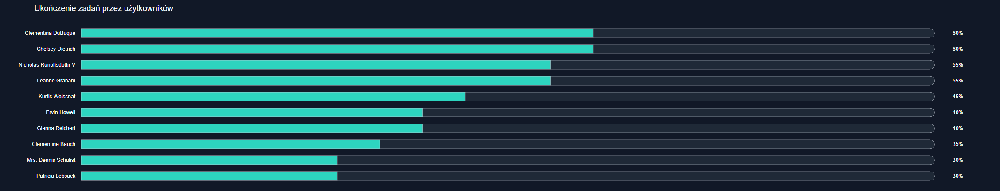
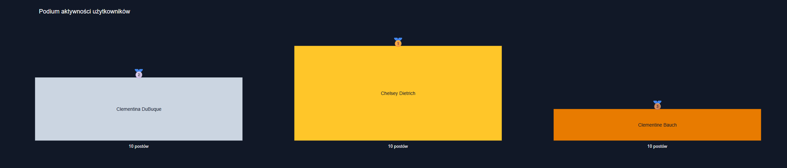

# Analiza danych z API JSONPlaceholder

Projekt pobiera dane z publicznego API JSONPlaceholder, oblicza podstawowe statystyki
i przedstawia wyniki na wykresach. Powstał jako zadanie rekrutacyjne.

**Demo:** [Otwórz notebook w Google Colab](https://colab.research.google.com/github/Wozniak-Kacper/analiza-danych-api/blob/main/analizaAPI.ipynb)

## Zrzuty ekranu

## Dane

Wykorzystałem cztery endpointy: /users, /posts, /comments i /todos. Ich wybór pozwala połączyć dane o użytkownikach z ich postami, komentarzami i zadaniami, wykorzystując identyfikatory userId oraz postId. Dzięki temu mogłem przeanalizować aktywność użytkowników, liczbę komentarzy oraz stopień realizacji zadań. Teksty postów i komentarzy mają charakter demonstracyjny, dlatego analiza koncentruje się na strukturze danych i wartościach liczbowych, a nie na treści tekstowej.

## Metryki i wykresy

- podstawowe statystyki dotyczące liczby użytkowników, postów, komentarzy i zadań,
- liczba postów i komentarzy przypisanych do poszczególnych użytkowników,
- odsetek ukończonych zadań w całym zbiorze i w podziale na użytkowników,
- trzy wizualizacje: wykres pierścieniowy realizacji zadań, wykres słupkowy ukończenia zadań przez użytkowników oraz podium aktywności.

## Najważniejsze wnioski

- Wykonanych jest 45% zadań (90 z 200).
- Odsetek wykonanych zadań różni się między użytkownikami (30%-60%).
- Posty i komentarze są rozłożone równomiernie (10 postów i 50 komentarzy na użytkownika).
- JSONPlaceholder to dane demonstracyjne, więc wyniki odzwierciedlają strukturę danych.

## Technologie

Python, pandas, requests, Plotly, Google Colab (Jupyter Notebook).

## Jak uruchomić

Otwórz notebook przez link „Demo” powyżej. Bez logowania do Google możesz przeglądać kod, opisy i zapisane wyniki. Aby uruchomić komórki i ponownie wykonać analizę, musisz zalogować się na konto Google.
Po zalogowaniu wybierz Środowisko wykonawcze → Uruchom wszystko. Notebook nie wymaga dodatkowej konfiguracji ani kluczy API.

## Proces pracy i użycie AI

To mój pierwszy projekt, w którym samodzielnie pobieram i analizuję dane z zewnętrznego API. Pythona poznałem wcześniej na uczelni podczas zajęć z uczenia maszynowego, a Google Colab poznałem na kolejnym przedmiocie, w ramach którego również będę pracował z Pythonem. Dlatego zdecydowałem się wykorzystać to środowisko w projekcie.

Rozważałem Streamlit, ale uruchomienie go w Colabie wymaga obejścia i daje link ważny tylko w trakcie sesji, więc wybrałem notebook”. 

**Jak korzystałem z AI:**

- **Plan projektu:** z pomocą AI (Claude) ustaliłem kolejne etapy pracy. Po przeanalizowaniu
  planu wprowadziłem własne korekty, zostawiając to, co uznałem za wartościowe, i odrzucając elementy zbędne.
- **Wybór danych:** samodzielnie sprawdziłem strukturę danych na stronie JSONPlaceholder i na jej podstawie
  wybrałem endpointy do analizy.
- **Kod:** generowałem go z pomocą AI (ChatGPT) fragmentami, krok po kroku. Każdy fragment
  analizowałem, wprowadzałem poprawki i starałem się zrozumieć, co robi. Część instrukcji, np. pobieranie danych z kolejnych endpointów, napisałem samodzielnie, aby lepiej poznać wykorzystywane biblioteki.
- **Metryki:** w kolejnych etapach sam decydowałem, jakie metryki policzyć (wybrałem te, które
  wydały mi się najciekawsze), i formułowałem odpowiednie prompty.
- **Opisy w notebooku i wnioski:** opisy dopracowywałem z pomocą AI (Claude, ChatGPT). Wykresy i wyniki
  analizowałem samodzielnie, a sformułowania wniosków przygotowałem z pomocą AI
  i dostosowałem do tego, co zaobserwowałem w danych.
